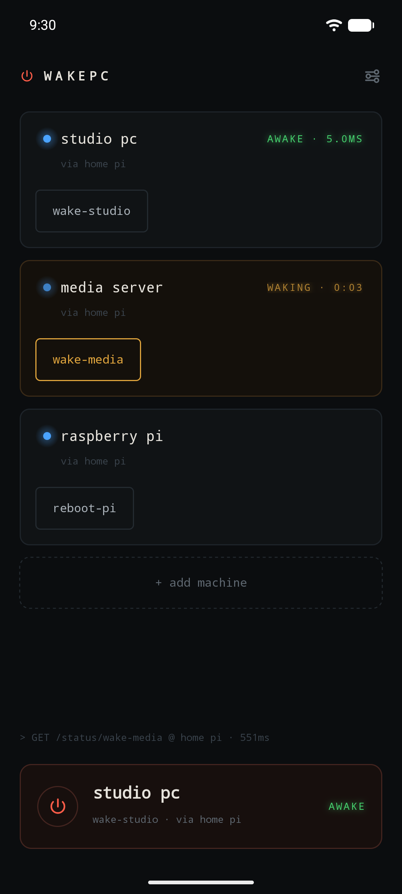
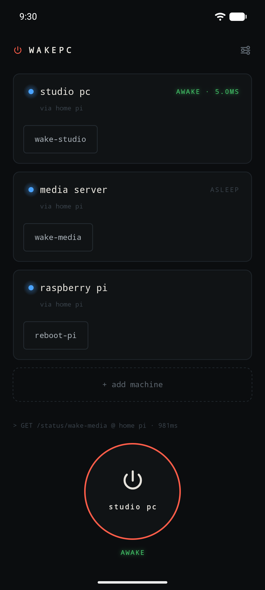

# WakePC

[](https://github.com/Bunbob41/WakePC/actions/workflows/ci.yml)
[](https://github.com/Bunbob41/WakePC/releases/latest)
[](LICENSE)

**Turn on your home PC from anywhere with one tap.** An Android app and a tiny
relay that runs on a Raspberry Pi, connected over Tailscale. No port
forwarding, no passwords to copy around, and it tells you when the machine is
actually awake.

<p align="center">
  
  &nbsp;&nbsp;
  
</p>

## Why it exists

Remote desktop tools can do almost anything to your PC, except turn it on. You
cannot connect to a machine that is switched off.

Wake-on-LAN can switch it on, but the "magic packet" that does it only travels
inside your home network. So something that is always on at home has to send it
for you. WakePC puts a small service on a Raspberry Pi to do exactly that, and
gives your phone a button for it.


## Features

- **One tap to wake**, from the app, a home screen widget, or a Quick Settings
  tile.
- **Real status.** The Pi pings the machine, so "awake" means it actually
  answered, with the response time.
- **No passwords.** The relay asks Tailscale which device is calling, so your
  phone is recognised automatically.
- **Several machines**, each with its own card, plus widgets in four sizes.
- **Nothing exposed to the internet.** The relay only listens on your private
  Tailscale network.
- **The phone cannot run arbitrary commands.** It can only press buttons you
  defined on the Pi.
- **Optional confirmation codes** for anything you would not want fired by a
  pocket tap.

## What you need

- An always-on Linux machine at home with `python3` and systemd. A Raspberry Pi
  is ideal; a NAS or home server works too.
- [Tailscale](https://tailscale.com) on that machine and on your phone, signed
  in to the same account.
- A PC with Wake-on-LAN switched on, connected by **ethernet cable**. Very few
  wifi cards can wake a machine that is off.
- An Android phone running Android 12 or newer.

## Setup

### 1. The relay on your Pi

```bash
git clone https://github.com/Bunbob41/WakePC.git
cd WakePC/pi
sudo ./install.sh
```

Then add your PC's network address (its MAC address) to `/etc/wakepc.conf` and
restart the service. [pi/README.md](pi/README.md) walks through it.

### 2. Wake-on-LAN on your PC

This part depends on your hardware, and it is where most problems come from.

1. **In the BIOS:** turn on the option usually called *Wake on LAN*, *Power On
   By PCI-E* or *Resume by LAN*. If there is an *ErP* or *deep sleep* setting,
   turn it off, because it cuts power to the network card.
2. **In Windows:** Device Manager → your ethernet adapter → Properties. Under
   *Advanced*, enable **Wake on Magic Packet**. Under *Power Management*, tick
   **Allow this device to wake the computer**.
3. **Fast Startup:** if waking from a full shutdown does not work, turn it off
   in Control Panel → Power Options → *Choose what the power buttons do*.

### 3. The app on your phone

1. Install Tailscale and sign in.
2. Download the APK from the
   [latest release](https://github.com/Bunbob41/WakePC/releases/latest) on your
   phone and open it. Android will ask you to allow installs from your browser
   the first time. To get updates automatically, add this repository to
   [Obtainium](https://github.com/ImranR98/Obtainium).
3. Add a connection with your Pi's Tailscale name or address. Leave the token
   empty.
4. Add a machine and choose its wake button.

## Troubleshooting

| Symptom | Likely cause |
| --- | --- |
| The app says *timed out* | Tailscale on the phone is asleep. Set Tailscale's battery use to **Unrestricted** in Android's app settings. |
| The app reaches the Pi but the PC does not turn on | Wake-on-LAN is off somewhere: check the BIOS, the adapter settings and Fast Startup (setup step 2). |
| It wakes from sleep but not from shut down | Usually Fast Startup, or an ErP/deep sleep setting in the BIOS. |
| A short name like `mypi` does not work | Use the full Tailscale name or the `100.x.y.z` address. |

On the Pi, `sudo -u wakepc python3 /opt/wakepc/wakepc.py status` shows the
address to use, who the relay will let in, and which commands need a code. In
the app, tap the line above the big button to see a log of every request.

## Shutting down from the phone (optional)

You probably do not need this, because any remote desktop tool already does
it. If you want shutdown, restart or sleep buttons anyway, the same relay can
run on the Windows PC itself. See [pc/README.md](pc/README.md).

## Security

- The relay only listens on its Tailscale address, so nothing on your home
  wifi or the internet can reach it.
- Callers are identified by Tailscale, and `allow_users` can limit access to
  named accounts.
- The phone can only run commands defined in the relay's config file, by name.
- Commands that interrupt a running machine can require a 6 digit code, checked
  by the relay itself.

## Documentation

- [docs/FIELD-GUIDE.md](docs/FIELD-GUIDE.md): how every piece works, in plain
  language with diagrams.
- [docs/ENGINEERING.md](docs/ENGINEERING.md): the design decisions, why they
  were made, and known gaps.
- [CHANGELOG.md](CHANGELOG.md): what changed in each version.

## Development

The app is Kotlin with Jetpack Compose and Glance widgets. The relay is a
single Python file using only the standard library. CI runs both test suites
on every push.

```bash
# Android: formatting, static analysis, unit tests, then build the APK
./gradlew spotlessCheck detekt testDebugUnitTest
./gradlew :app:assembleRelease

# Relay (from pi/): lint and tests
ruff check .
python -m unittest -v
```

## Licence

[MIT](LICENSE). Use it, change it and share it freely.
