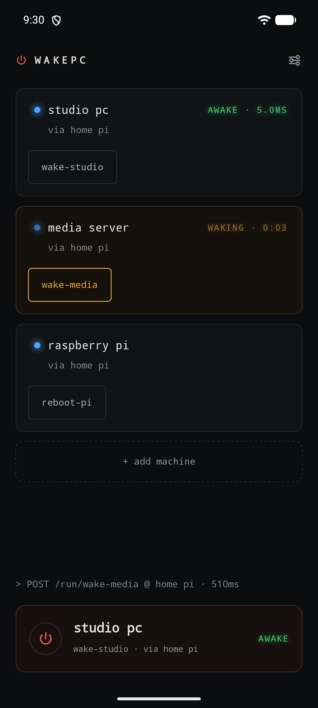
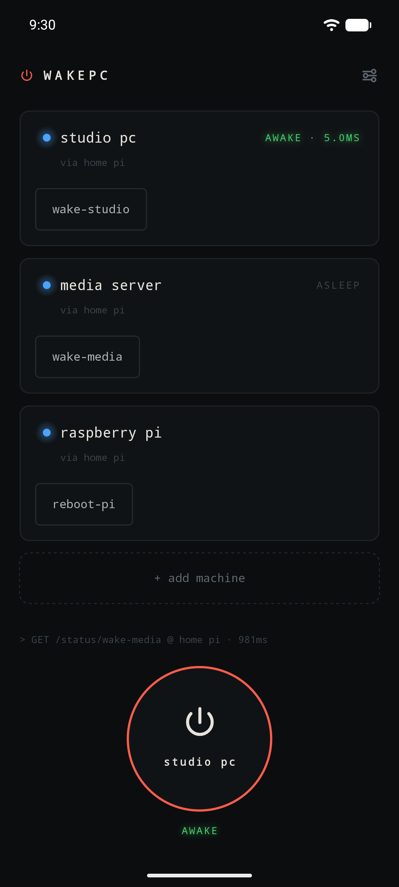

# WakePC

[](https://github.com/Bunbob41/WakePC/actions/workflows/ci.yml)
[](https://github.com/Bunbob41/WakePC/releases/latest)
[](LICENSE)

**Turn on your home PC from anywhere with one tap.** An Android app and a tiny
relay that runs on any computer you leave on at home: a Raspberry Pi, a NAS, a
spare PC in the garage. They talk over Tailscale. No port forwarding, no
passwords to copy around, no config files to edit, and it tells you when the
machine is actually awake.

<p align="center">
  
  &nbsp;&nbsp;
  
</p>

## Why it exists

Remote desktop tools can do almost anything to your PC, except turn it on. You
cannot connect to a machine that is switched off.

Wake-on-LAN can switch it on, but the "magic packet" that does it only travels
inside your home network. So something that is always on at home has to send it
for you. WakePC puts a small service, the relay, on a computer that stays on
to do exactly that, and gives your phone a button for it.


## Features

- **One tap to wake**, from the app, a home screen widget, or a Quick Settings
  tile.
- **Setup that checks itself.** Type the relay's name, pick your PC from a list
  the relay finds on your network, then wake it while the app shows each
  stage. If something is wrong, it says which link broke.
- **Real status.** The relay pings the machine, so "awake" means it actually
  answered, with the response time.
- **Knows when it is usable.** A PC answers ping early in its boot. The relay
  notes a port the PC opens later, and the app shows UP while it is still
  starting and READY once you can use it.
- **Says what is wrong.** "Can't reach the relay" and "the PC did not answer"
  are different problems and the app tells them apart. It also warns you
  before the relay's Tailscale key expires.
- **No passwords.** The relay asks Tailscale which device is calling, so your
  phone is recognised automatically.
- **Several machines**, each with its own card, plus widgets in four sizes.
- **Nothing exposed to the internet.** The relay only listens on your private
  Tailscale network.
- **The phone cannot run arbitrary commands.** It can add a machine to wake,
  and press buttons you defined on the relay. Nothing else.
- **Optional confirmation codes** for anything you would not want fired by a
  pocket tap.

## What you need

- A computer at home that **stays on**, to be the relay. A Raspberry Pi is
  ideal. A NAS, a home server or a spare Windows PC works too.
- [Tailscale](https://tailscale.com) on the relay and on your phone, signed in
  to the same account.
- A PC with Wake-on-LAN switched on, connected by **ethernet cable**. Very few
  wifi cards can wake a machine that is off.
- An Android phone running Android 12 or newer.

## Setup

### 1. The relay

On a Raspberry Pi or any Linux machine with `python3` and systemd:

```bash
git clone https://github.com/Bunbob41/WakePC.git
cd WakePC/pi
sudo ./install.sh
```

On a Windows PC, in PowerShell opened as Administrator, from the `pc` folder:

```powershell
powershell -ExecutionPolicy Bypass -File .\install.ps1 -Relay
```

Either one prints an address when it finishes. That is the only thing you
carry over to the phone. There is no config file to edit.
[pi/README.md](pi/README.md) and [pc/README.md](pc/README.md) have the details.

### 2. Wake-on-LAN on your PC

This part depends on your hardware, and it is where most problems come from.

1. **In the BIOS:** turn on the option usually called *Wake on LAN*, *Power On
   By PCI-E* or *Resume by LAN*. If there is an *ErP* or *deep sleep* setting,
   turn it off, because it cuts power to the network card.
2. **In Windows:** Device Manager → your ethernet adapter → Properties. Under
   *Advanced*, enable **Wake on Magic Packet**. Under *Power Management*, tick
   **Allow this device to wake the computer**.
3. **Fast Startup:** if waking from a full shutdown does not work, turn it off
   in Control Panel → Power Options → *Choose what the power buttons do*.

### 3. The app on your phone

1. Install Tailscale and sign in.
2. Download the APK from the
   [latest release](https://github.com/Bunbob41/WakePC/releases/latest) on your
   phone and open it. Android will ask you to allow installs from your browser
   the first time. To get updates automatically, add this repository to
   [Obtainium](https://github.com/ImranR98/Obtainium).
3. Open the app and follow its three steps:
   - **Connect:** type the address the relay printed.
   - **Pick your PC:** with the PC switched on, choose it from the list of
     devices the relay can see, and give it a name.
   - **Test it:** shut the PC down, then tap wake and watch it come up. If it
     does not, the app lists what to check.

## Keeping the relay reachable

The relay is the one part that has to stay up, so:

- **It must not sleep.** The Windows installer offers to turn sleep off.
- **It should start again after a power cut.** In its BIOS, set *restore on AC
  power loss* to *power on*. A Raspberry Pi does this already.
- **Its Tailscale key must not expire.** In the Tailscale admin console, open
  the relay's menu and choose *Disable key expiry*. Otherwise it drops off
  your tailnet after about six months. The app warns you two weeks ahead.

## Troubleshooting

| Symptom | Likely cause |
| --- | --- |
| *Tailscale looks off on this phone* | Open Tailscale and connect. If it keeps dropping, set its battery use to **Unrestricted** in Android's app settings. |
| *No answer from* the relay, or **NO RELAY** on a card | The relay is off, asleep, or off your tailnet. Check it in the Tailscale app: an expired key shows there. |
| The relay *is on, but wakepc is not running on it* | Restart the service: `sudo systemctl restart wakepc`, or re-run the installer. |
| **PC DID NOT ANSWER** | The relay sent the wake, so Wake-on-LAN is off somewhere: check the BIOS, the adapter settings and Fast Startup (setup step 2). |
| Your PC is not in the list during setup | It has to be switched on to be seen, and on the same network as the relay. Tap *scan again*. |
| It wakes from sleep but not from shut down | Usually Fast Startup, or an ErP/deep sleep setting in the BIOS. |
| A short name like `mypi` does not work | Use the full Tailscale name or the `100.x.y.z` address. |

On a Linux relay, `sudo -u wakepc python3 /opt/wakepc/wakepc.py status` shows
the address to use, who the relay will let in, and the machines it knows. In
the app, tap the line above the big button to see a log of every request.

## Shutting down from the phone (optional)

You probably do not need this, because any remote desktop tool already does
it. If you want shutdown, restart or sleep buttons anyway, the same relay can
run on the Windows PC itself. See [pc/README.md](pc/README.md).

## Security

- The relay only listens on its Tailscale address, so nothing on your home
  wifi or the internet can reach it.
- Callers are identified by Tailscale, and `allow_users` can limit access to
  named accounts.
- The phone can register a machine for the relay to wake, which can only ever
  turn that machine on. Set `phone_setup = no` on the relay to forbid even that.
- Anything else the phone can do is a command defined in the relay's config
  file, pressed by name. It can never send a command of its own.
- Commands that interrupt a running machine can require a 6 digit code, checked
  by the relay itself.

## Documentation

- [docs/FIELD-GUIDE.md](docs/FIELD-GUIDE.md): how every piece works, in plain
  language with diagrams.
- [docs/ENGINEERING.md](docs/ENGINEERING.md): the design decisions, why they
  were made, and known gaps.
- [CHANGELOG.md](CHANGELOG.md): what changed in each version.

## Development

The app is Kotlin with Jetpack Compose and Glance widgets. The relay is a
single Python file using only the standard library. CI runs both test suites
on every push.

```bash
# Android: formatting, static analysis, unit tests, then build the APK
./gradlew spotlessCheck detekt testDebugUnitTest
./gradlew :app:assembleRelease

# Relay (from pi/): lint and tests
ruff check .
python -m unittest -v
```

## Licence

[MIT](LICENSE). Use it, change it and share it freely.
